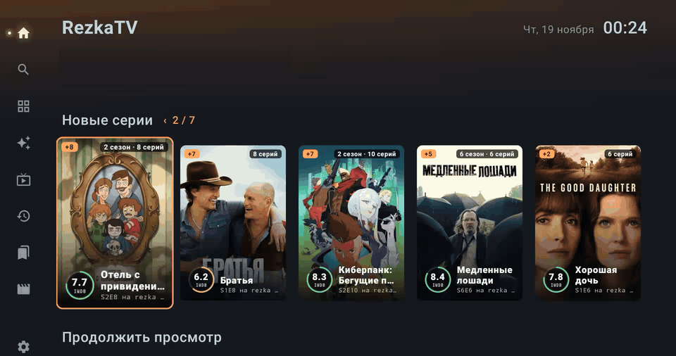
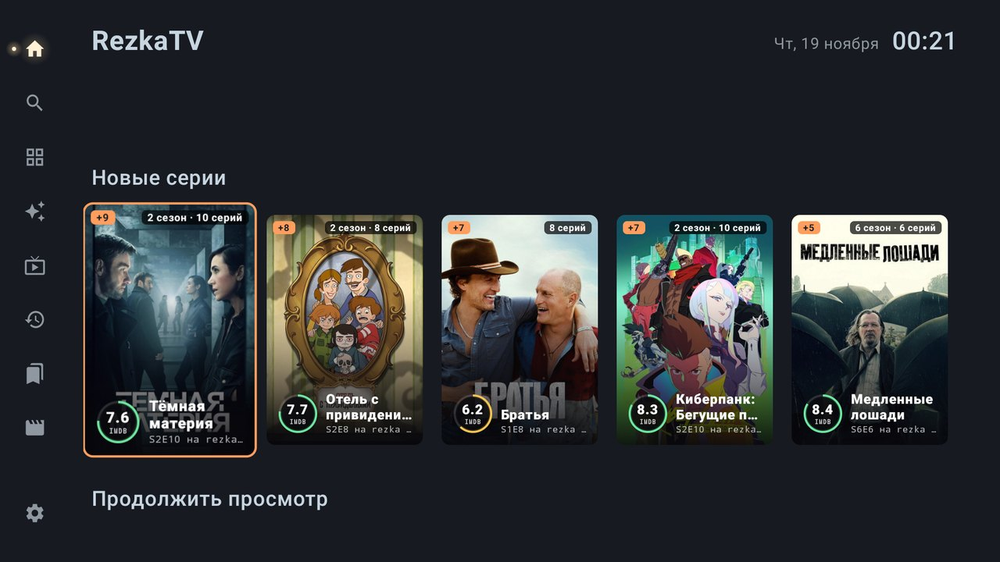
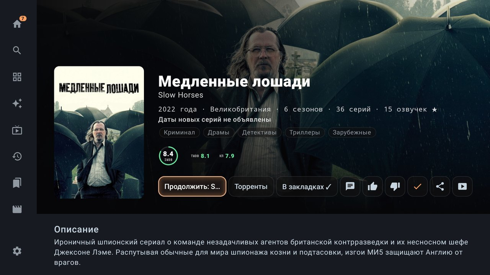
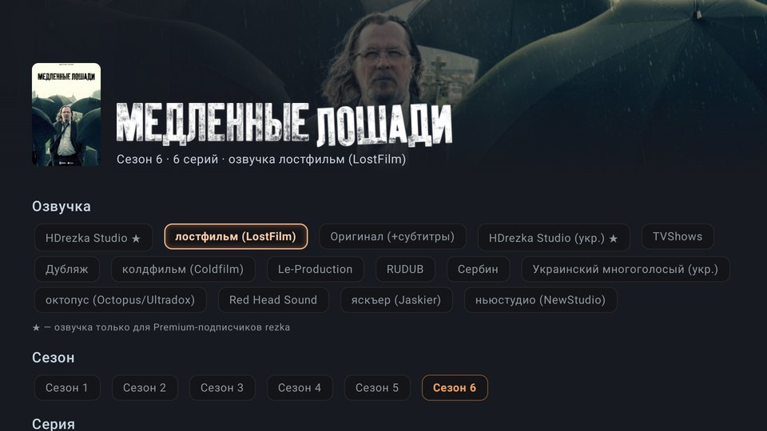
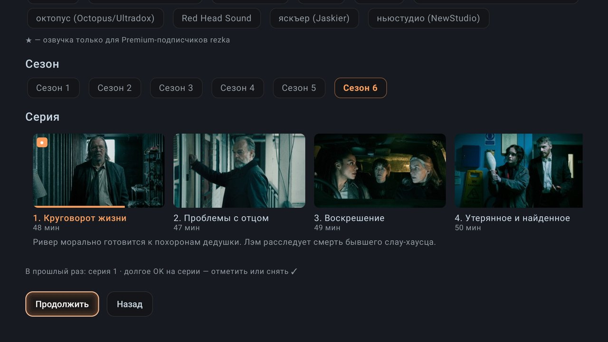
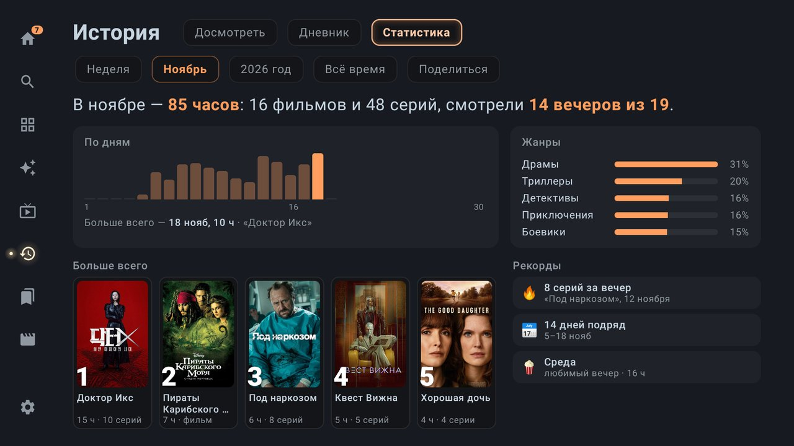
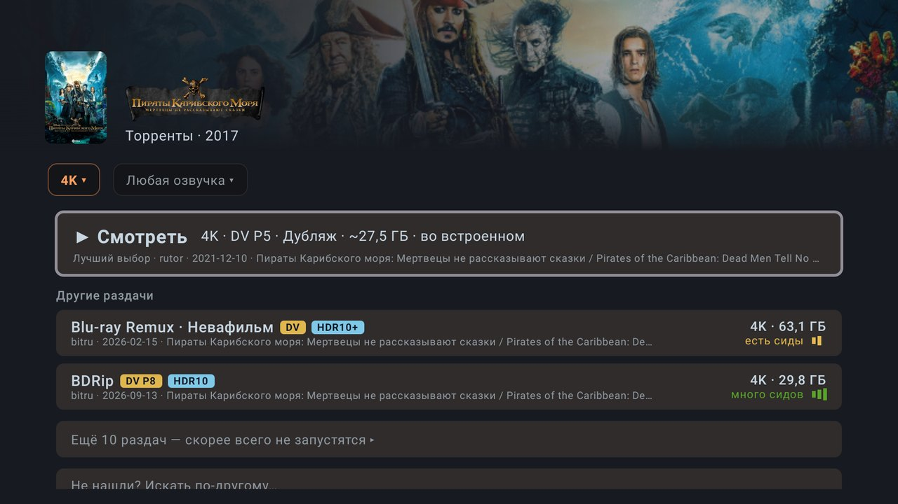

# RezkaTV

**Приложение для Android TV: фильмы и сериалы с HDrezka на телевизоре — пультом, без браузера.**

  

## Возможности

| | |
|---|---|
| 🏠 **Главная** — новые серии ваших сериалов, «Продолжить просмотр», новинки и популярное | ✨ **«Для вас»** — подборки под ваш вкус: по тому, что вы смотрели, и по оценкам в Letterboxd |
| 🎙 **Озвучки и качество** — популярные озвучки сверху, приложение помнит выбор для каждого сериала | ⏭ **Без лишних нажатий** — продолжение с того же места, следующая серия сама, «Пропустить заставку» |
| ▶️ **Свой плеер или любимый** — встроенный или внешний: Just Player, VLC, MX Player и другие | 🧲 **Торренты** (по желанию) — раздачи через ваш TorrServer, фильтры и значки 4K / HDR / Dolby Vision |
| 🧭 **Запасной источник** — если rezka недоступна, фильмы, сериалы и аниме (AniLibria) ищутся на других сайтах; есть режим «Без rezka» | 👨‍👩‍👧 **Семья** (по желанию) — «Продолжить» общий для всех телевизоров дома, советы фильмов близким, «Поделиться» по QR-коду |
| 📖 **Дневник и статистика** — всё, что посмотрели, по месяцам: часы, жанры, любимое, рекорды | ⭐ **Оценки на постерах** — IMDb, TMDB и Кинопоиск |
| 🎞 **Letterboxd** (по желанию) — ваши оценки, «Хочу посмотреть» и популярные подборки | 📺 **Сервисы** — витрины Netflix, HBO, Кинопоиска и других |
| 🔖 **Закладки** — папки, общие для телевизоров семьи | 🔍 **Поиск** — текстом или голосом с пульта |
| 🔄 **Обновляется само** — новая версия приходит прямо в приложение | 🌙 **Вечером** — таймер сна и «Ночной звук»: тихие сцены громче, взрывы тише |

## Как это выглядит

<table>
<tr>
<td width="50%"> <b>Главная</b> — новые серии, оценки, сколько вышло с прошлого раза</td>
<td width="50%"> <b>Страница тайтла</b> — описание, оценки, «Продолжить», торренты, закладки</td>
</tr>
<tr>
<td> <b>Озвучка и сезон</b> — ★ отмечены озвучки только для Premium</td>
<td> <b>Серии</b> — кадры, описание, где остановились в прошлый раз</td>
</tr>
<tr>
<td> <b>Статистика</b> — часы, жанры, любимое и рекорды за месяц, год и всё время</td>
<td> <b>Торренты</b> — лучшая раздача сверху, значки DV / HDR10+</td>
</tr>
</table>

## Что нужно

- Телевизор или приставка на **Android TV** (Android 7 и новее).
- **Аккаунт HDrezka с подпиской Premium.** По правилам сайта сторонние приложения можно использовать только с Premium; без неё вместо фильма сайт показывает рекламный ролик. У каждого пользователя — свой аккаунт.
- Для торрентов — **TorrServer** на компьютере, NAS или телефоне в той же домашней сети.

## Как установить

1. Скачайте `.apk` из [Releases](../../releases/latest) на телевизор (например, через «Downloader» или флешку).
2. Откройте файл и разрешите установку из этого источника, если телевизор спросит.
3. Запустите RezkaTV и войдите в свой аккаунт HDrezka.

## Обновления

Ставить вручную нужно только первый раз. Когда выходит новая версия, в приложении появится «Доступно обновление» — нажмите «Обновить». Проверить вручную можно в Настройках: «Проверить обновления». Что изменилось — в описании каждого [релиза](../../releases).

## Вопросы и новости

Telegram-канал **[Пульт и диван](https://t.me/pult_i_divan)**: новые версии, ответы на вопросы, идеи — пишите в комментариях под постами.

## Важно и честно

**Это неофициальное приложение, оно не связано с HDrezka.** Приложение ничего не хранит и не раздаёт само — оно показывает то, что сайт даёт вашему аккаунту. Пароль не сохраняется: вход хранится только на вашем телевизоре.

Что уходит с телевизора, кроме запросов к самому сайту:

| Куда | Что и когда |
|---|---|
| **Отчёты об ошибках** (Sentry) | Когда приложение падает или что-то ломается: экран, модель ТВ, версия, техническая ошибка. Без логина, cookie, названий фильмов, поиска и ссылок на видео; IP-адрес не сохраняется. Выключается в Настройках: «Отправлять отчёты об ошибках». |
| **Сервер «Семья»** (только если вы его включили) | Случайные номера семьи и устройств, имена телевизоров, которые вы дали, на какой серии и минуте остановились, советы близким, снимок дневника для «Поделиться» (живёт 7 дней). Не принимает логины, пароли, cookie rezka, поисковые запросы и IP-адреса. |
| **Справочные сервисы** | TMDB (постеры, описания, оценки), файл оценок IMDb, Shikimori (обложки аниме), Wikidata и AniList (сопоставить номера фильма на разных сайтах), IntroDB и AniSkip (где заставка). Туда уходят только номера фильмов и серий. |
| **По вашему действию** | Letterboxd — если подключили; JacRed и ваш TorrServer — когда ищете торренты; сайты запасного источника — когда он включён и понадобился; GitHub — проверка обновлений. |

---

**English:** RezkaTV is an unofficial Android TV client for HDrezka, not affiliated with the site. It needs your own HDrezka Premium account; the site's rules allow third-party apps only with Premium. This repository holds release builds only.
